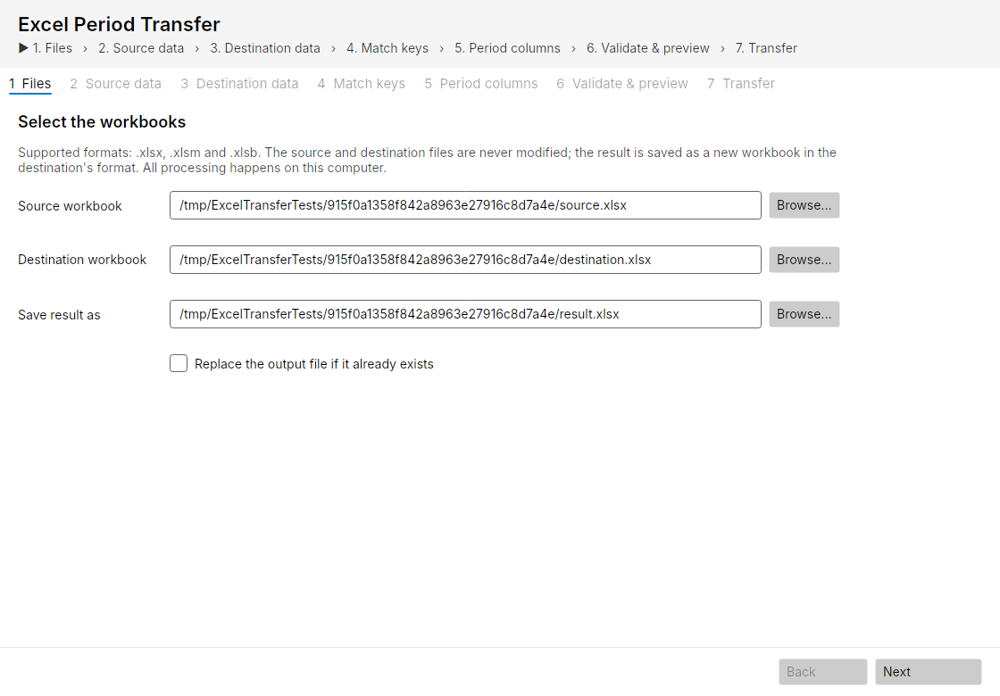
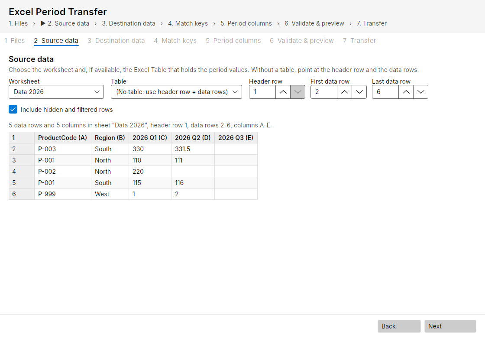
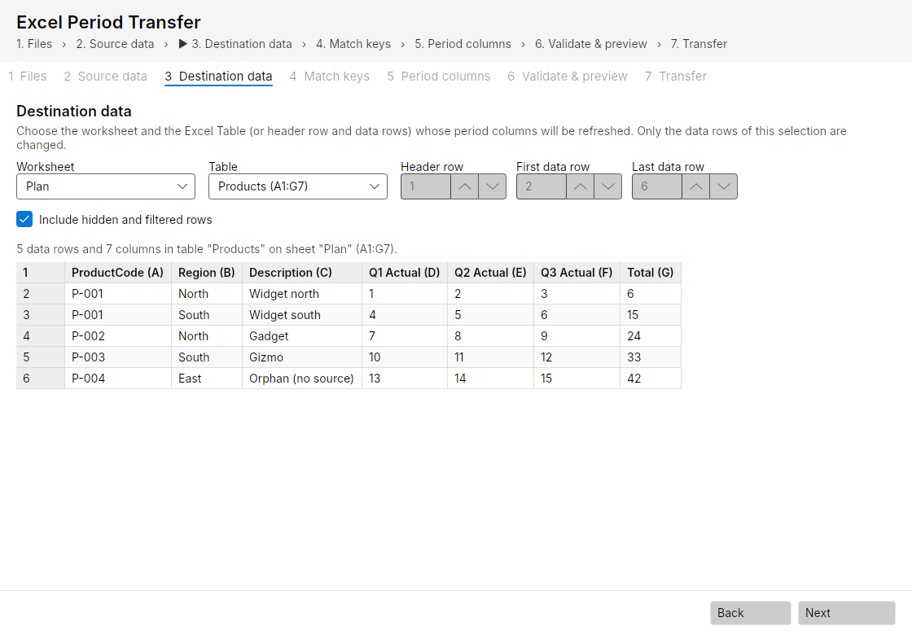
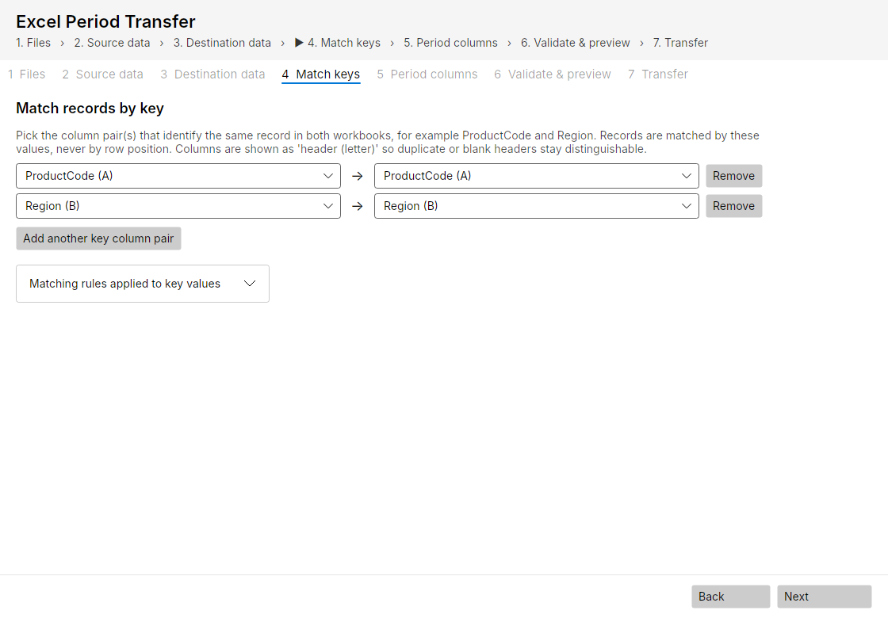
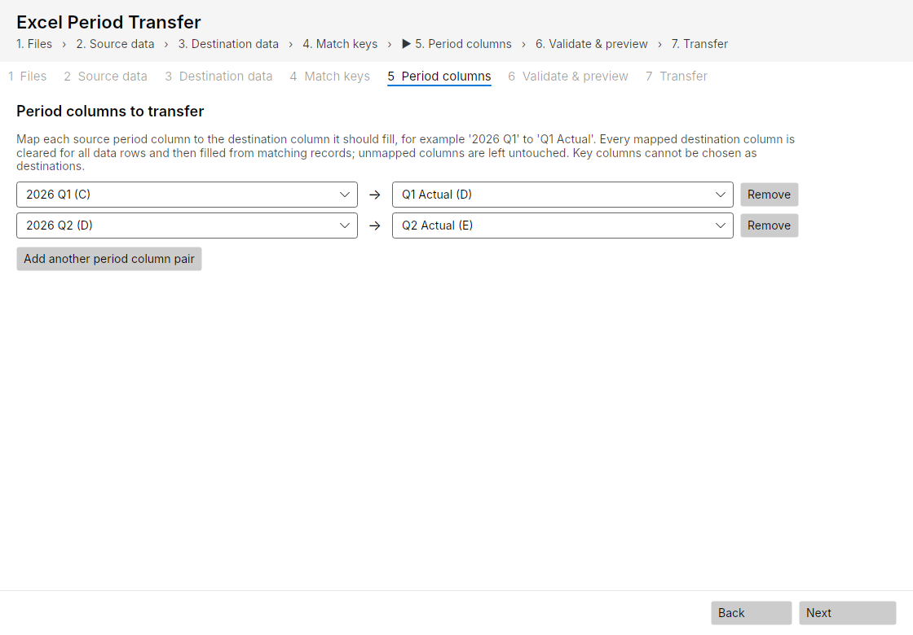
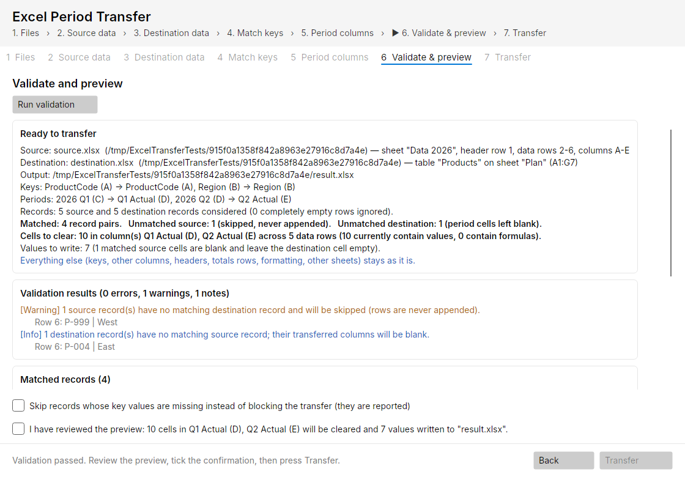
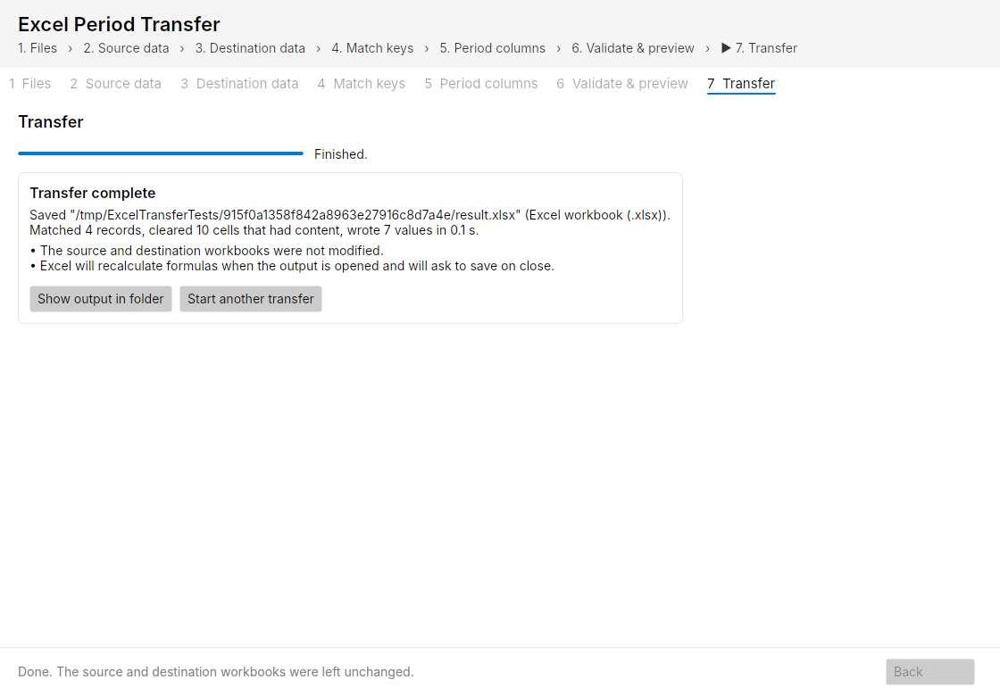

# Excel Period Transfer - user guide

## What it does

You have a workbook with new period values (for example `2026 Q1`, `2026 Q2`) and a planning workbook with a
table that must receive them (for example into `Q1 Actual`, `Q2 Actual`). The rows are not in the same order and
may not be the same rows. The application matches rows by key columns you choose (for example *ProductCode* and
*Region*), clears the chosen destination columns, fills in the matching values and saves the result as a **new**
workbook. Your original files are never changed.

Supported files: `.xlsx`, `.xlsm` (macros kept) and `.xlsb`. The result has the same format as the destination.

## Starting the application

Copy `ExcelPeriodTransfer.exe` anywhere (or the app on macOS) and double-click it. Nothing is installed.
On first start Windows may show "Windows protected your PC" because the file is new/unsigned: choose
*More info* -> *Run anyway*, or ask IT to sign or whitelist the file.

## The seven steps

The window walks you through the steps below; **Back** and **Next** move between them.

### 1. Files

* **Source workbook**: the file that contains the new period values.
* **Destination workbook**: the file whose table must be refreshed.
* **Save result as**: leave empty to get `<destination name> - updated.<same extension>` next to the destination.
  The output must not be one of the input files. Tick *Replace the output file if it already exists* only if you mean it.

If a file cannot be used you see why directly under its box (wrong type, password protected, open elsewhere, ...).

### 2. Source data

Pick the worksheet. If the sheet contains an Excel Table it is preselected; otherwise choose
*No table* and check the suggested **header row**, **first data row** and **last data row**. The preview shows
the first rows so you can confirm the selection. Columns are shown as `Header (letter)`, so two columns with the
same header stay distinguishable.

*Include hidden and filtered rows* is on by default. Switch it off to ignore hidden rows entirely.

### 3. Destination data

Same as step 2, for the table that receives the values. For an Excel Table, header and totals rows are handled
automatically. For an ordinary range make sure the **last data row** does not include notes or total lines below
the data (such rows have no key and would block the transfer).

### 4. Match keys

Add one row per key column pair: the source column on the left, the destination column that holds the same
identifier on the right. Use several pairs for composite keys (ProductCode + Region). The *Matching rules*
section explains exactly when two values count as equal (spaces and letter case are ignored, leading zeros are
not, "123" equals 123, dates match dates, ...).

### 5. Period columns

Add one row per column to transfer, for example `2026 Q1 (C) -> Q1 Actual (D)`. Every destination column you map
is **cleared for all data rows** and then filled from the matching source rows. Columns you do not map are never
touched. Key columns cannot be chosen as destinations.

### 6. Validate and preview

Validation runs automatically (press *Run validation* to repeat it). You see:

* a summary: how many records matched, how many source rows have no destination (they are skipped and listed),
  how many destination rows have no source (their mapped cells stay blank), the exact columns and number of
  cells that will be cleared, and the number of values to write;
* errors (red) that block the transfer, warnings (orange) and notes (blue), each with the affected rows;
* the matched pairs and the unmatched records on both sides;
* the matching rules.

Typical blocking errors and what to do:

| Message | What to do |
|---|---|
| key(s) occur more than once | Each key must identify exactly one row on each side. Fix the duplicates in Excel or add another key column (for example Region). The tool never guesses which duplicate to use. |
| record(s) have missing or invalid key values | Fill in the keys, narrow the data rows, or tick *Skip records whose key values are missing* if those rows should simply be left out. |
| formulas whose results are not stored | Open the source in Excel, let it calculate, save, and validate again. |
| sheet is protected / merged cells / shared formula group / calculated column | Prepare the destination in Excel as the message says (unprotect, unmerge, convert formulas to values, remove the column formula). |
| output file must not overwrite / already exists / is open | Choose another name, or close the file in Excel, or tick the replace option. |

When everything is green, tick the confirmation box and press **Transfer**.

### 7. Transfer

The application copies the destination, applies the changes to the copy, reads the copy back to verify every
cell and every untouched part, and only then saves it under the chosen name. The summary shows the output path
and the counts; *Show output in folder* opens the folder.

Open the result in Excel. Excel recalculates all formulas when the file opens (totals, formulas that depend on the
transferred values) and will therefore ask whether to save when you close it - say yes.

## Good to know

* Values are copied, not formulas. If a source cell contains a formula, the value Excel stored at the last save is copied.
* Blank source cells leave the destination cell blank.
* Text, numbers, dates, TRUE/FALSE and error values are copied as they are. Dates written into cells that had no date
  format receive a date format automatically.
* Rows are never added to the destination. Source rows without a match are listed so you can add them manually.
* Everything else stays as it was: headers, key columns, unmapped columns, totals rows, formatting, other sheets,
  charts, pivot tables, macros, comments.
* `.xlsb` results: this version writes binary workbooks with the project's own code. Open the first result in Excel
  and check it; if Excel ever reports a problem, keep the file and report it.
